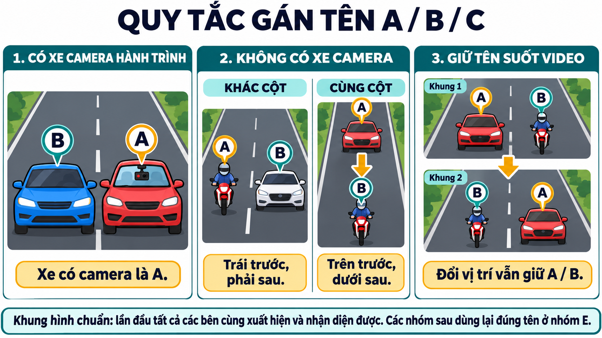

# Hướng dẫn gán nhãn Nhóm E: thực thể (Entities)

- Câu hỏi chuẩn: Loại phương tiện và màu xe của các bên liên quan là gì?
- Chỉ khai báo tối đa 2 bên chính: cặp của va chạm đầu tiên; không có va chạm thì cặp của tình huống suýt va chạm đầu tiên.
- Phương tiện tự trượt hoặc tự lật mà không có bên nào khác (C là K18) thì chỉ khai báo 1 bên.
- Phương tiện nền và các bên của va chạm xảy ra sau đó không khai báo; form không cho thêm bên thứ ba (từ codebook E.v5, 2026-11-23).
- Không ghi màu áo người đi bộ (từ codebook E.v6, 2026-11-23); màu xe vẫn ghi. Hai bên cùng loại và cùng màu phân biệt bằng tên A, B.
- Mỗi phương tiện hoặc bên liên quan là một thực thể riêng, có tên ổn định A, B, C xuyên suốt video; tên thực thể không phụ thuộc vào loại hoặc màu.
- Nếu trong các bên liên quan có đúng một xe có camera hành trình, gán xe đó là A. Gán các bên còn lại theo vị trí ở khung hình đầu tiên tất cả các bên liên quan cùng xuất hiện và nhận diện được: từ trái sang phải; nếu nằm gần như cùng một cột thì từ trên xuống dưới.
- Nếu không có xe camera hành trình, gán tất cả các bên theo vị trí ở khung hình đầu tiên tất cả các bên liên quan cùng xuất hiện và nhận diện được: từ trái sang phải; nếu nằm gần như cùng một cột thì từ trên xuống dưới.
- Nếu có nhiều hơn một xe camera hành trình, xếp các xe đó theo quy tắc trái-sang-phải, trên-xuống ở khung hình đầu tiên tất cả các bên cùng xuất hiện; xe camera đứng đầu là A, rồi gán các bên còn lại theo cùng thứ tự vị trí.
- Giữ nguyên tên khi các bên đổi vị trí, cắt ngang nhau, bị che khuất rồi xuất hiện lại. Dùng tính liên tục giữa các khung hình, quỹ đạo và vai trò trong sự kiện để theo dõi từng bên; không đổi tên theo vị trí mới.
- Hai thực thể cùng loại vẫn nhận hai tên riêng, ví dụ "xe máy A" và "xe máy B" hoặc "ô tô A" và "ô tô B". Không cần dựa vào màu để phân biệt chúng.
- Khi so giữa hai annotator, ghép thực thể theo danh tính của phương tiện trong video và tính liên tục theo thời gian, không chỉ theo loại hoặc màu. Nếu không thể xác định chắc chắn thực thể nào tương ứng, báo người phụ trách để phân xử thay vì đoán.
- Các nhóm C, O, R, Attr và Prev dùng lại đúng tên A, B, C đã gán ở nhóm E.
- Mỗi ô chọn đúng một giá trị. Không nhìn rõ ô nào thì chọn "không rõ".
- Bên bị che hoàn toàn hoặc quá xa để nhận diện thì không khai báo; không khai báo được bên nào thì câu trả lời là "Không thể xác định".

## Các ô (cho mỗi bên)

| Ô | Lựa chọn | Khi nào điền |
| --- | --- | --- |
| 1. Loại | ô tô · xe khách · xe tải · xe cứu thương · xe máy · xe đạp · xe ba gác · người đi bộ · động vật | Luôn điền |
| 2. Cỡ | to · nhỏ | Chỉ với xe khách, xe tải |
| 3. Camera hành trình | có · không | Chỉ với ô tô |
| 4. Số người trên xe | 1 · 2 · 3 trở lên | Chỉ với xe máy, xe hai bánh, xe máy điện, xe đạp điện |
| 5. Màu xe | trắng, xám/bạc · đen · đỏ · xanh · vàng | Bắt buộc với phương tiện có màu; không áp dụng ô tô có dashcam, xe đạp, người đi bộ và động vật |

Gộp trắng, xám, ghi và bạc vào một lựa chọn "trắng, xám/bạc".
Không dùng màu khác, không rõ, tối hoặc nâu; chỉ chọn màu trong danh sách hiện hành khi nhìn thấy đủ rõ.
Không ghi loại xe chi tiết hơn bảng trên (không "tay ga", không "24-29 chỗ"), không ghi biển số, khuôn mặt.
Xe container và xe bán tải ghi là xe tải.
Xe máy gồm xe số, xe tay ga, xe côn tay và xe máy điện (không có bàn đạp).
Xe đạp gồm xe đạp thường và xe đạp điện (có bàn đạp).
Xe ba gác gồm mọi xe 3 bánh, kể cả các loại xe tự chế; không gộp vào xe máy hoặc xe đạp.
Không còn lựa chọn "khác": mỗi bên được xếp vào một loại trong bảng trên.

## Mẫu câu

| Loại | Mẫu câu cho một bên |
| --- | --- |
| Ô tô có camera hành trình | Xe ô tô (có camera hành trình) |
| Ô tô khác | Xe ô tô màu [5] (không có camera hành trình) |
| Xe khách, xe tải | [1] [2] màu [5] |
| Xe máy | Xe máy màu [5] (chở [4] người, khi từ 2 trở lên) |
| Xe đạp | Xe đạp |
| Xe cứu thương, xe ba gác | [1] màu [5] |
| Người đi bộ | Người đi bộ |
| Động vật | Động vật |

Câu trả lời ghép các bên theo thứ tự A, B, C, nối bằng dấu phẩy, kết thúc bằng dấu chấm.
Ô "không rõ" thì bỏ vế đó khỏi câu.
