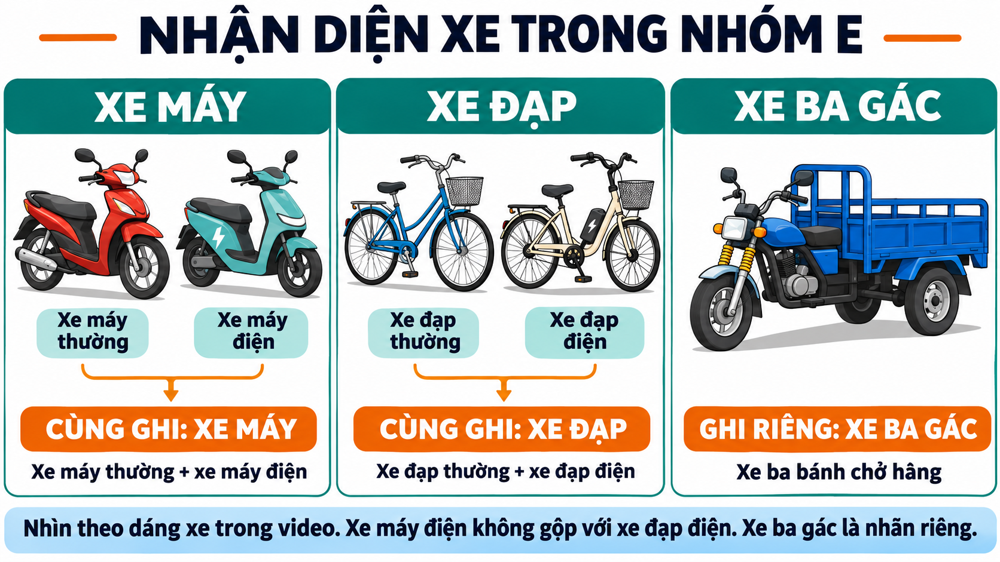

# Hướng dẫn gán nhãn Nhóm E: thực thể (Entities)

- Câu hỏi chuẩn: Loại phương tiện và màu sắc của các bên liên quan là gì?
- Chỉ khai báo các bên trực tiếp va chạm hoặc suýt va chạm. Phương tiện nền chỉ khai báo khi có tác động đến sự việc.
- Mỗi phương tiện hoặc bên liên quan là một thực thể riêng, có tên ổn định A, B, C xuyên suốt video; tên thực thể không phụ thuộc vào loại hoặc màu.
- Nếu trong các bên liên quan có đúng một xe có camera hành trình, gán xe đó là A. Gán các bên còn lại theo vị trí ở khung hình đầu tiên tất cả các bên liên quan cùng xuất hiện và nhận diện được: từ trái sang phải; nếu nằm gần như cùng một cột thì từ trên xuống dưới.
- Nếu không có xe camera hành trình, gán tất cả các bên theo vị trí ở khung hình đầu tiên tất cả các bên liên quan cùng xuất hiện và nhận diện được: từ trái sang phải; nếu nằm gần như cùng một cột thì từ trên xuống dưới.
- Nếu có nhiều hơn một xe camera hành trình, xếp các xe đó theo quy tắc trái-sang-phải, trên-xuống ở khung hình đầu tiên tất cả các bên cùng xuất hiện; xe camera đứng đầu là A, rồi gán các bên còn lại theo cùng thứ tự vị trí.
- Giữ nguyên tên khi các bên đổi vị trí, cắt ngang nhau, bị che khuất rồi xuất hiện lại. Dùng tính liên tục giữa các khung hình, quỹ đạo và vai trò trong sự kiện để theo dõi từng bên; không đổi tên theo vị trí mới.
- Hai thực thể cùng loại vẫn nhận hai tên riêng, ví dụ "xe máy A" và "xe máy B" hoặc "ô tô A" và "ô tô B". Không cần dựa vào màu để phân biệt chúng.
- Khi so giữa hai annotator, ghép thực thể theo danh tính của phương tiện trong video và tính liên tục theo thời gian, không chỉ theo loại hoặc màu. Nếu không thể xác định chắc chắn thực thể nào tương ứng, báo người phụ trách để phân xử thay vì đoán.
- Các nhóm C, O, R, Attr và Prev dùng lại đúng tên A, B, C đã gán ở nhóm E.
- Mỗi ô chọn đúng một giá trị. Không nhìn rõ ô nào thì chọn "không rõ".
- Bên bị che hoàn toàn hoặc quá xa để nhận diện thì không khai báo; không khai báo được bên nào thì câu trả lời là "Không thể xác định".

## Các ô (cho mỗi bên)

| Ô | Lựa chọn | Khi nào điền |
| --- | --- | --- |
| 1. Loại | ô tô · xe khách · xe tải · xe cứu thương · xe máy · xe đạp · xe ba gác · người đi bộ · động vật · khác | Luôn điền |
| 2. Cỡ | to · nhỏ | Chỉ với xe khách, xe tải |
| 3. Camera hành trình | có · không | Chỉ với ô tô |
| 4. Màu xe | trắng · đen · xám, bạc · đỏ · xanh · vàng · nâu · màu khác · màu sáng · màu tối · không rõ | Bỏ trống với ô tô có camera hành trình, người đi bộ, động vật |
| 5. Màu áo người điều khiển | như ô 4 | Chỉ với xe máy, xe hai bánh, xe máy điện, xe đạp điện và người đi bộ |
| 6. Số người trên xe | 1 · 2 · 3 trở lên | Chỉ với xe máy, xe hai bánh, xe máy điện, xe đạp điện |

Ghi màu cụ thể chỉ khi nhìn rõ. Ban đêm, xa hoặc ngược sáng thì chọn "màu sáng" hoặc "màu tối".
Không ghi loại xe chi tiết hơn bảng trên (không "tay ga", không "24-29 chỗ"), không ghi biển số, khuôn mặt.
Xe container và xe bán tải ghi là xe tải.
Xe máy điện được ghi là xe máy; xe đạp điện được ghi là xe đạp.
Xe ba gác là nhãn riêng cho xe ba bánh chở hàng.

## Mẫu câu

| Loại | Mẫu câu cho một bên |
| --- | --- |
| Ô tô có camera hành trình | Xe ô tô (có camera hành trình) |
| Ô tô khác | Xe ô tô màu [4] |
| Xe khách, xe tải | [1] [2] màu [4] |
| Xe máy | Xe máy màu [4] do người mặc áo [5] điều khiển (chở [6] người, khi từ 2 trở lên) |
| Xe đạp | Xe đạp màu [4] |
| Xe cứu thương, xe ba gác, khác | [1] màu [4] |
| Người đi bộ | Người đi bộ mặc áo [5] |
| Động vật | Động vật |

Câu trả lời ghép các bên theo thứ tự A, B, C, nối bằng dấu phẩy, kết thúc bằng dấu chấm.
Ô "không rõ" thì bỏ vế đó khỏi câu, ví dụ không rõ màu áo thì chỉ ghi "Xe máy màu đen".
