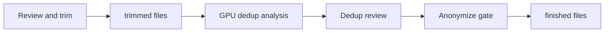
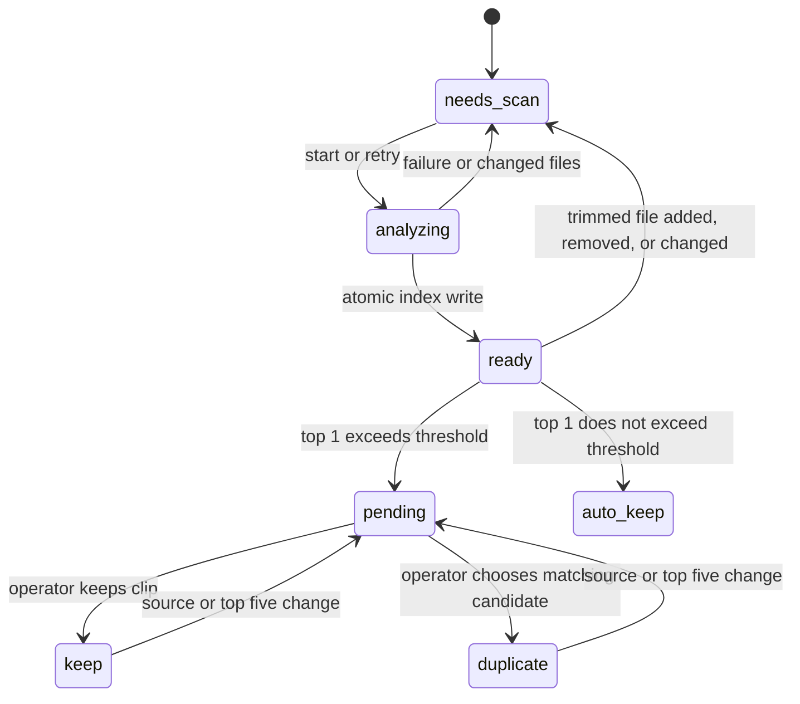

# Dedup after trim

Status: verified
Owner: local Next.js frontend and FastAPI sidecar
Depends on: approved files in `work/*/trimmed/`, DINOv2 Base GPU cache
Consumed by: anonymize sweep into `finished/`

## Outcome and boundary

The operator analyzes approved trimmed clips, reviews only queries whose best fused match exceeds the saved threshold, and then anonymizes the clips that remain.
The starting threshold is 0.80 and the comparison is strictly greater than.
The page shows one query at a time with its top five candidates.
Trimmed source files remain available for correction.

## Confirmed decisions

- The score is the equal-weight mean of DINOv2 cosine and pHash similarity on the best ordered run of four sampled frames.
- One frame embedding and one pHash are extracted for each of eight sampled frames per trimmed video.
- Every query is compared with every other current trimmed clip before top five are selected.
- Queries below or equal to the threshold pass automatically.
- Queries above the threshold require a durable keep or duplicate decision before anonymization starts.

## System relationship

## State lifecycle

## Data and recovery

The analysis index stores relative file paths, size and modification-time signatures, top five scores, and a review fingerprint based on the query and its candidates.
The database stores one review decision per query path, with the fingerprint and optional duplicate target.
The saved threshold lives in the same database and starts at 0.80.
An atomic index replacement keeps the previous completed analysis intact when a scan fails.
The sidecar rejects anonymize start if the index is missing or stale or any above-threshold query is pending.
The worker verifies the gate again when it starts.
Changing the threshold re-evaluates the existing index and decisions without rerunning the model.
When files change, the UI explains that a rescan is required.
Marking a query duplicate preserves its trimmed source and moves any pre-existing finished copy into `artifacts/dedup/excluded_finished/`.
Reversing that decision leaves the archived copy intact; the operator can regenerate a fresh finished copy through anonymize.
The gate rejects a cycle of duplicate-of decisions, so at least one clip remains in each reviewed chain.

## Acceptance criteria

- At 0.80, the queue contains only queries with fused top 1 strictly greater than 0.80.
- The query page shows top five videos and can save keep or duplicate-of-candidate decisions across reloads.
- An anonymize start fails with an actionable reason until analysis is fresh and all above-threshold queries are decided.
- A re-trimmed file invalidates analysis and cannot inherit a previous decision.
- A failed scan can be retried without corrupting the last completed index.
