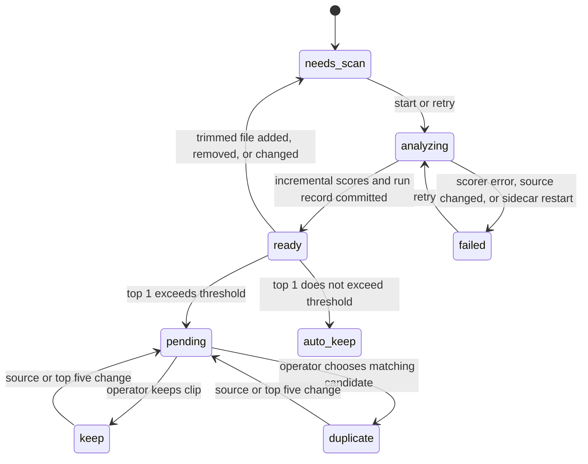

# Dedup after trim

Status: implementing incremental comparison and run history
Owner: local Next.js frontend and FastAPI sidecar
Depends on: approved files in `work/*/trimmed/`, DINOv2 Base GPU cache
Consumed by: anonymize sweep into `finished/`

## Outcome and boundary

The operator analyzes approved trimmed clips, reviews only queries whose best fused match exceeds the saved threshold, and then anonymizes the clips that remain.
The starting threshold is 0.80 and the comparison is strictly greater than.
The page shows one query at a time with its top five candidates.
Trimmed source files remain available for correction.

## Confirmed decisions

- The score is the equal-weight mean of DINOv2 cosine and pHash similarity on the best ordered run of four sampled frames.
- One frame embedding and one pHash are extracted for each of eight sampled frames per trimmed video.
- Every query is compared with every other current trimmed clip before top five are selected.
- The operator can start another comparison after trimmed clips are added or changed.
- Persist each unordered source pair score with its two source signatures and scoring version. Reuse unchanged pair scores across runs.
- A new or changed clip is compared with every other current clip. Removed clips lose only their related pair scores.
- If the current index has no pair-score baseline, the first upgraded run compares all pairs once to seed it.
- Keep the last completed index and pair-score baseline when a run fails. Record each attempt in durable run history, including a failed attempt after sidecar restart.
- Preserve a review decision when that query's source signature and ordered top five remain unchanged. Require review again when either changes.
- Queries below or equal to the threshold pass automatically.
- Queries above the threshold require a durable keep or duplicate decision before anonymization starts.

## System relationship

## State lifecycle

## Data and recovery

The analysis index stores relative file paths, size and modification-time signatures, top five scores, and a review fingerprint based on the query and its candidates.
SQLite stores reusable pair scores and one row per run attempt with start/end time, outcome, source change counts, computed pair count, and error details.
The database stores one review decision per query path, with the fingerprint and optional duplicate target.
The saved threshold lives in the same database and starts at 0.80.
The index is written to a temporary file before publishing; a failed run keeps the previous completed index and reusable pair scores intact.
The sidecar tracks the worker PID in history so status and new-start checks can recognize a worker that outlives a sidecar restart; a dead worker with a `running` row is marked interrupted and can be retried.
The sidecar rejects anonymize start if the index is missing or stale or any above-threshold query is pending.
The worker verifies the gate again when it starts.
Changing the threshold re-evaluates the existing index and decisions without rerunning the model.
When files change, the UI explains that a comparison is required and offers a button to run it.
Marking a query duplicate preserves its trimmed source and moves any pre-existing finished copy into `artifacts/dedup/excluded_finished/`.
Reversing that decision leaves the archived copy intact; the operator can regenerate a fresh finished copy through anonymize.
The gate rejects a cycle of duplicate-of decisions, so at least one clip remains in each reviewed chain.

## Acceptance criteria

- At 0.80, the queue contains only queries with fused top 1 strictly greater than 0.80.
- The query page shows top five videos and can save keep or duplicate-of-candidate decisions across reloads. A candidate action can atomically mark the current query as a duplicate and the selected candidate as the clip to keep.
- An anonymize start fails with an actionable reason until analysis is fresh and all above-threshold queries are decided.
- A re-trimmed file invalidates analysis and cannot inherit a previous decision.
- After adding one trimmed file, a run scores it against all current clips and does not recompute unchanged pairs.
- Editing one source invalidates and recomputes only its pairs; deleting one source removes only its pairs.
- The history shows completed, failed, and interrupted attempts with source counts, pair counts, and actionable errors.
- Re-running with no source changes computes zero pairs and leaves unchanged review decisions intact.
- A failed scan can be retried without corrupting the last completed index.
